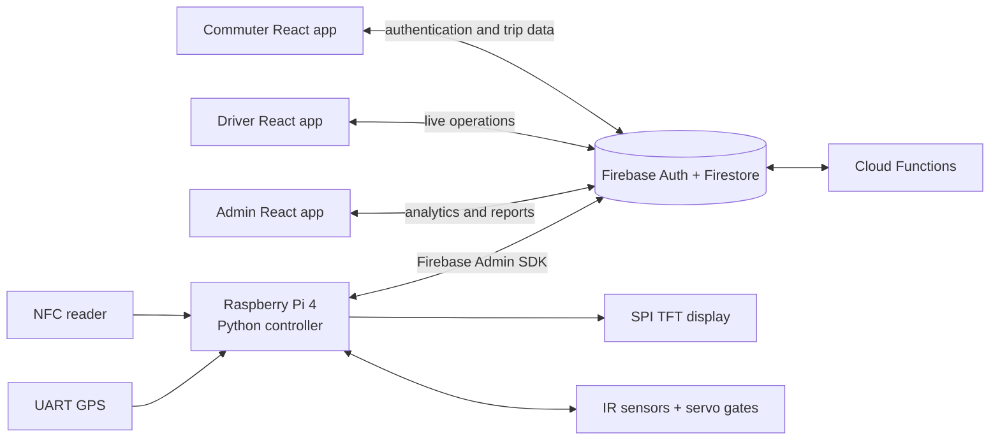

# Automated Fare Collection System

**Official capstone title:** *Automated Fare Collection System with Seat Allocation, Terminal Selection, and Profit Analytics Dashboards*


An academic prototype for modern-jeepney fare collection that connects a **Raspberry Pi 4 hardware controller** to commuter, driver, and administrator web applications. The system coordinates NFC card taps, route-based fare calculation, GPS terminal detection, seat occupancy, automated gates, cloud transactions, and operational dashboards.

This repository is presented as a **five-person capstone project**. My primary contribution was leading the team and developing, integrating, and testing the Python-based Raspberry Pi subsystem—not independently building every component.

[Architecture](#system-architecture) · [Embedded system](#embedded-system) · [Testing](#testing-and-evidence) · [Run locally](#run-the-web-applications) · [Technical tutorial](docs/SYSTEM_TUTORIAL.md)

## Problem and solution

Manual fare collection makes it difficult to connect passenger validation, route selection, seat availability, fare deductions, and operator reporting. This project explores a single workflow in which:

- commuters select a route and use an NFC card;
- the vehicle device validates the passenger and controls seat access;
- GPS and calibrated terminal data identify the vehicle's current terminal;
- fare and occupancy changes are synchronized through Firebase; and
- driver and administrator dashboards expose live operating data and reports.

## Implemented capabilities

| Area | Repository evidence |
|---|---|
| **NFC validation** | The firmware reads card UIDs through a PC/SC reader, resolves users, validates account status and balance, and rejects duplicate taps. |
| **Fare processing** | A terminal-to-terminal fare matrix is enforced by the firmware and Cloud Functions; Firestore transactions protect balance deductions and event processing from duplicate execution. |
| **Seat allocation** | Per-seat state machines coordinate NFC taps, gate servos, IR occupancy sensors, pending timeouts, and seat-release events. |
| **GPS terminal detection** | NMEA data is filtered by fix quality, satellite count, HDOP, smoothing, terminal radius, and hysteresis to reduce unstable terminal switching. |
| **Passenger application** | The commuter React app provides authentication, email verification, balance and trip information, terminal selection, profile settings, and transaction history. |
| **Operations applications** | Separate driver and administrator React apps expose passenger/route operations, shift and expense data, revenue summaries, terminal activity, and report generation. |
| **Cloud integration** | Firebase Authentication, Firestore, Cloud Functions, security rules, and Hosting connect the device and three web applications. |

> The NFC implementation in [`firmware_src.txt`](firmware_src.txt) reads a card UID with an APDU command. The repository does not demonstrate cryptographic DESFire authentication, so this README does not claim it.

## System architecture



The firmware uses the Firebase Admin SDK to write device, tap, seat, and GPS data to Firestore. The web applications use Firebase client SDKs and real-time listeners. Cloud Functions process tap and seat events and use Firestore transactions where atomic updates are required.

## Fare and boarding workflow

1. A commuter signs in, completes the email verification flow, and selects origin and destination terminals.
2. The Raspberry Pi reads the NFC card UID and looks up the associated user record.
3. The firmware checks system availability, account state, selected route, required fare, duplicate taps, pending boarders, and available seats.
4. For an accepted tap, the selected gate opens and the device waits for the corresponding IR sensor.
5. The IR event confirms occupancy or a timeout restores the seat to its available state.
6. Firestore-triggered Cloud Functions claim unprocessed events and atomically update balance, passenger state, seat count, and transaction history.
7. Commuter, driver, and administrator interfaces receive the resulting updates through Firebase listeners.

## Embedded system

The embedded implementation is stored in [`firmware_src.txt`](firmware_src.txt). It is a Python program intended for a Linux-based Raspberry Pi 4 and integrates the following components:

| Component | Interface or library | Responsibility |
|---|---|---|
| ACR1252U-compatible NFC reader | PC/SC via `pyscard` | Card UID acquisition and passenger lookup |
| GPS receiver | UART via `pyserial` and `pynmea2` | Position fixes and terminal detection |
| ILI9488 TFT | SPI via `luma.lcd` and Pillow | Passenger-facing validation feedback |
| Two IR sensors | Raspberry Pi GPIO | Physical seat occupancy confirmation |
| Two servo gates | PWM via `pigpio` | Seat-entry access control |
| Firestore | `firebase-admin` | Device events, user validation, GPS data, and synchronization |

### Engineering decisions visible in the firmware

- **Explicit seat states:** `AVAILABLE`, `PENDING`, and `OCCUPIED` prevent ambiguous gate behavior.
- **Duplicate-tap protection:** the same UID cannot claim another seat while boarding or seated.
- **Sensor debouncing and timeouts:** configurable timing protects against transient IR signals and abandoned boarding attempts.
- **GPS stabilization:** smoothing, accuracy thresholds, dwell time, exit margin, and switch bias address noisy real-world GPS readings.
- **Failure feedback:** the display distinguishes unavailable services, invalid or inactive cards, missing destinations, insufficient balances, duplicate taps, and full capacity.
- **Cloud transaction safety:** Cloud Functions claim events and update related Firestore documents in transactions to reduce duplicate charges and race conditions.

## Technology stack

| Layer | Technologies |
|---|---|
| Embedded | Python 3, Raspberry Pi 4, `firebase-admin`, `pyscard`, `pyserial`, `pynmea2`, Pillow, `luma.lcd`, `pigpio` |
| Frontend | React 18, React Router 6, Vite 5, JavaScript, CSS |
| Backend and data | Firebase Authentication, Cloud Firestore, Cloud Functions, Firestore Security Rules |
| Reporting and visualization | Recharts, jsPDF, jsPDF AutoTable |
| Deployment | Firebase Hosting; static-hosting guidance for Hostinger is also included |
| Hardware protocols | PC/SC, UART, SPI, GPIO, PWM |

## Repository map

```text
firmware_src.txt               Raspberry Pi Python source (stored as text)
src/                           Commuter React application
4CPEA-11-DRIVER/               Driver React application
4CPEA-11-ADMIN/                Administrator React application
functions/                     Primary Firebase Functions codebase (Node 20)
cpe-11/                        Additional Firebase Functions codebase (Node 24)
firestore.rules                Database authorization rules
scripts/build-all.js           Combined three-application production build
docs/SYSTEM_TUTORIAL.md        Detailed architecture and code walkthrough
```

## Run the web applications

### Prerequisites

- Git
- Node.js 20 and npm for the web applications and primary Functions codebase
- A Firebase project if you want working authentication, Firestore, Functions, and hosting
- Firebase CLI for emulator or deployment workflows

The secondary `cpe-11/` Functions package declares Node.js 24 and should be treated separately if it is deployed.

### Install

```bash
git clone https://github.com/Reniel-Relearn/capstone-design-project-AFCS.git
cd capstone-design-project-AFCS

npm install
npm --prefix 4CPEA-11-ADMIN install
npm --prefix 4CPEA-11-DRIVER install
```

Each frontend imports its own `src/firebase/config.js`. Use a Firebase project you control when reproducing the system. Example configuration templates are available for the commuter and administrator applications. Do not commit service-account files, email application passwords, or other server-side credentials.

> `npm ci` is not currently suitable for the root project because the committed root lockfile is out of sync with `package.json`. Use `npm install` until the team intentionally regenerates and reviews that lockfile.

### Start one interface

```bash
npm run dev
# Commuter: http://localhost:3000/Commuter/

npm --prefix 4CPEA-11-DRIVER run dev
# Driver: http://localhost:5173/Driver/

npm --prefix 4CPEA-11-ADMIN run dev
# Admin: http://localhost:5174/Admin/
```

Run each command in a separate terminal when using all three applications.

### Build all interfaces

```bash
npm run build:all
```

The combined output is written to `dist-combined/` with `/Commuter/`, `/Driver/`, and `/Admin/` subpaths.

### Reproducing the hardware subsystem

The embedded code cannot be fully exercised without the Raspberry Pi, reader, GPS receiver, TFT, sensors, servos, calibrated terminal data, display assets, and Firebase credentials. The repository does not include a pinned Python requirements file or a hardware-in-the-loop simulator; inspect [`firmware_src.txt`](firmware_src.txt) before attempting deployment.

## Testing and evidence

The capstone team performed functional, integration, system, expert, and user evaluation. The supporting workbooks are published in anonymized form so the calculations can be reviewed without exposing respondent identities:

- [Technical test execution results](docs/evidence/AFCS_Test_Execution_Results.xlsx)
- [Expert and user evaluation results](docs/evidence/AFCS_Evaluation_Results_Anonymized.xlsx)

Independent recalculation of the test scoreboard confirms **21 test categories**, **2,188 executions**, **2,156 correct outcomes**, **32 incorrect or limited outcomes**, and a **98.54% aggregate success rate**. These are prototype-validation results, not a production availability or reliability guarantee.

The evaluation workbook contains responses from **12 expert evaluators** and **100 user respondents**. Its summary calculations produce an expert mean of **4.56/5** and a combined user mean of **4.56/5**. The previously reported user score of 4.57/5 was corrected after checking both user-evaluation sections together.

No automated JavaScript/Python test suite or continuous-integration test report is committed. The test workbook also retains one Google Sheets-specific `MINUS` formula in a timing-analysis cell that may display `#NAME?` when recalculated in Excel; it does not affect the published category totals or aggregate success rate.

As part of this documentation audit, `npm run build:all` successfully produced production bundles for the commuter, driver, and administrator applications. Vite reported bundle-size and mixed dynamic/static import warnings, but no build failure.

## Contributions and ownership

### Reniel Galang — team lead and embedded-software contributor

- Led a five-person capstone team, coordinated assignments, schedules, integration work, and progress reporting.
- Primarily developed the Python application used on the Raspberry Pi 4.
- Programmed and integrated NFC, GPS, TFT, IR-sensor, servo, and Firestore workflows.
- Performed hardware programming, unit-level checks, and cross-component integration testing.
- Helped troubleshoot GPS instability and hardware-integration issues.
- Executed tests and consolidated results produced across the team.

### Collaborative work

The commuter, driver, and administrator applications; Firebase services; physical prototype; documentation; and evaluation activities were team outputs. Commit history and repository contributors provide additional attribution. This README intentionally does not represent the complete system as one person's independent work.

## Known limitations and production considerations

- Physical hardware and the deployed Firebase project are required for end-to-end reproduction.
- Public evidence workbooks exclude direct respondent identifiers; raw identifying questionnaires and signed records remain private.
- There is no committed automated test suite or continuous-integration workflow.
- The root lockfile is not synchronized with `package.json`, and dependency installation reports deprecated packages and security-audit findings; dependencies should be reviewed before production use.
- `verificationCodes/{email}` is currently open in `firestore.rules`; the detailed tutorial correctly identifies this as unsuitable for production and recommends server-only access.
- App Check, rate limiting, production secret management, and stricter account-provisioning controls require additional hardening.
- Firmware dependencies are not pinned in a `requirements.txt`, and hardware/display configuration remains environment-specific.

## Documentation

- [Guided system tutorial](docs/SYSTEM_TUTORIAL.md)
- [Hostinger deployment guide](HOSTINGER_DEPLOYMENT.md)
- [Firebase configuration](firebase.json)
- [Firestore rules](firestore.rules)
- [Raspberry Pi firmware](firmware_src.txt)

## Recommended portfolio captures

The repository currently contains logos and interface assets but no curated end-to-end screenshot set. Useful additions would be: the physical Raspberry Pi prototype, NFC validation on the TFT, GPS terminal detection, commuter route selection, driver seat/manifest monitoring, and administrator profit analytics. These should be captured from the real running system rather than reconstructed for documentation.
